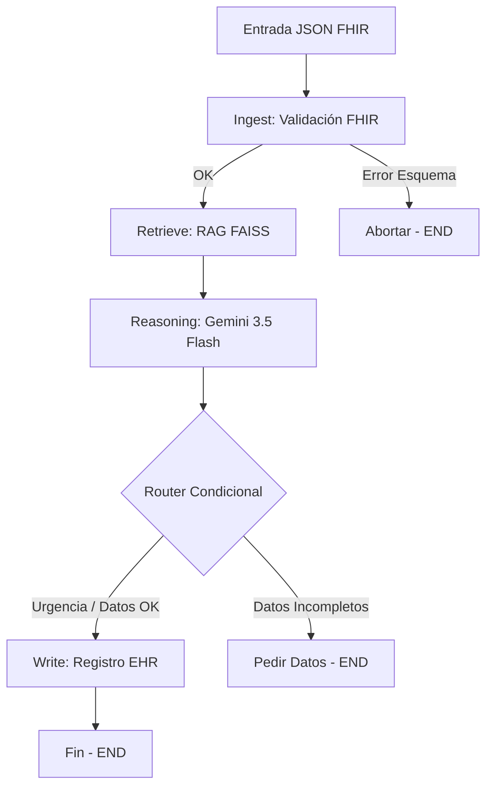

# 🏥 Nexus-V Vitalis: Agente Clínico Autónomo (EP2)

**Asignatura:** Ingeniería de Soluciones con IA (ISY0101) — Duoc UC  
**Tecnologías:** LangGraph, LangChain, Google Gemini (`gemini-3.5-flash`), FHIR (Pydantic), FAISS  

---

## 📌 Descripción

**Nexus-V Vitalis** es un agente clínico diseñado para **Clínica Vitalis**. Procesa datos de pacientes en formato FHIR, recupera guías médicas mediante RAG, toma decisiones adaptativas ante urgencias clínicas y registra la atención en el EHR.

---

## 🏗️ Arquitectura del Grafo (LangGraph)



---

## 🛠️ Componentes y Herramientas

* **Memoria Episódica (STM):** `TypedDict` para estado episódico y Pydantic v2 para validación FHIR anti *Schema Drift*.
* **Memoria Semántica (LTM):** FAISS + embeddings de Google para consulta de guías clínicas GES e historial médico.
* **Herramientas:**
  1. `tool_consultar_vectorstore_vitalis`: Consulta RAG a la base vectorial.
  2. `tool_escribir_ficha_ehr`: Persistencia de notas clínicas en el sistema EHR.

---

## 🚀 Instalación y Ejecución

### 1. Requisitos
```bash
pip install -q -U langchain-google-genai langgraph fhir.resources faiss-cpu pydantic pandas langchain-community
```

### 2. Configurar API Key
```bash
export GOOGLE_API_KEY="tu_api_key_aqui"
```

### 3. Ejecutar Agente
```bash
python agent_vitalis.py
```

---

## 🧪 Escenarios de Prueba (IE7)

* **Escenario 1 (Flujo Exitoso):** Recibe paciente `pac-001` (Marcela Soto), detecta presión arterial de $178/112\text{ mmHg}$, decide `ESCALAMIENTO_URGENTE` y registra en el EHR.
* **Escenario 2 (Resistencia a Errores):** Recibe JSON con tipos inválidos, detiene el flujo de forma segura en el nodo de ingesta sin contaminar el registro médico.

---

## 👥 Integrantes
* Fernanda Lazo y Benjamin Perez
